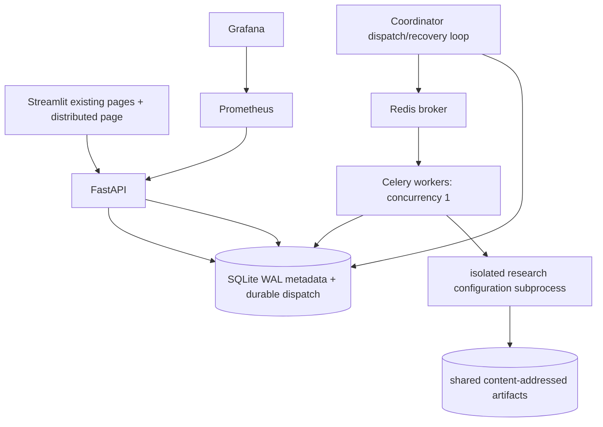

# Audit and architecture

## Baseline (before implementation)

Exact commits, source hashes, historical result hashes and manifest hashes are in
`baseline.json`. Analyzer: `9277132d4b8b07fe7172f4af02ba94813aad5fd4`.
Research: `d845bc63dc00cf3333bc602134645f871d22e8cc`.
Research has an existing untracked `make_dataset_heatmap.py`; it is outside this work.
Both local checkouts identify the GitHub repositories requested by the task.
No research source or historical output needs editing: the required independent
configuration entry point already exists. The new compatibility adapter lives here.
The latest task explicitly authorizes all phases, feature branches and commits,
overriding the older phase/branch restrictions in research `AGENTS.md`.

## Existing lifecycle traced from source

`app.py` and `pages/{1_Single_Retrieval,2_Compare_Chunkers}.py` call
`services.live_ui.run`; `load_model` caches a CPU MiniLM resource. The backend
adapter inserts research `src` into sys.path. `document_service.extract_pdf`
produces session-local page text and a SHA-256 upload identity.
`research_backend.create_chunks` calls `retrieval_pipeline.chunk_document`;
`build_retrieval_index` calls `embed_chunk_texts`, `create_index`, `add_vectors`;
`search_document` calls `embed_query` and `retrieve_one`. Indexes are session-local.
`3_Research_Dashboard.py` uses `results_service` to read six bundled saved artifacts.
Existing five offline tests exercise documents, saved data, navigation and UI state.

Research `run_experiment.main` prepares official queries then launches one fresh
process per configuration with `--config CHUNKER NOISE`. `read_qas` calls
`ohrbench_adapter.load_pages` and `official_qa.load_mapped_qas`: 8,498 annotations,
42 exclusions, 8,456 primary / 5,277 context-verified, sorted by query ID.
`prepare_queries` caches normalized float32 384-dimensional query vectors.
`build_configuration` iterates documents in sorted document/page order, calls
`chunk_document`, embeds batches of 32, appends to exact `IndexFlatIP`, and saves
FAISS and positional source metadata. `run_configuration` retrieves top 100,
uses `retrieval_metrics.score_ranking` with document-and-page overlap relevance,
and atomically writes query batches of 128. `aggregate_completed` assembles CSVs.
`analyze_results.aggregate` and `paired_bootstrap` produce the historical summaries
and paired confidence intervals. None of these algorithms are replaced.

Frozen parameters: 254 content tokens, fixed/recursive overlap 32,
semantic threshold .15/minimum 64/maximum 254, structure maximum 254;
normalized MiniLM, FAISS insertion/ranking order, page relevance, MRR@100 unchanged.
The old `docs/EXPERIMENT_PLAN.md` has stale statements that the runner is empty;
executable code, completed manifest and saved artifacts establish current behavior.

## Risks identified

Research defaults assume cwd is the research root. Global RESULTS/INDEXES and
fixed `.tmp` paths make simultaneous unwrapped invocations unsafe. Existing cache
checks primarily counts and run ID, not file integrity/content identity. The runner
reports Darwin ru_maxrss units even on Linux; platform operational RSS is recorded
separately without changing historical profiles. Requirements are a local snapshot,
research dependencies mostly unpinned. Docker/Linux wheels require validation.
FAISS thread count is process-global. No legacy Celery/API/job metadata exists.

## New execution boundary

SQLite WAL with BEGIN IMMEDIATE, busy timeout and short transactions is selected
for a single Docker host and local filesystem volume. PostgreSQL would be required
before multi-host scheduling; SQLite/WAL or file locks must never use an NFS share.
Multiple worker containers here demonstrate single-host multi-process execution,
not multi-machine scaling. One configuration per child isolates model/FAISS state.
Default is one worker; two/four are opt-in and may exceed an 8 GB machine's budget.

## Contracts, persistence and failure model

A job freezes selected configurations, input identity and mode. Stable UUID5 task
IDs derive from job + chunker + noise. Submission idempotency keys prevent duplicate
jobs. SQLite is authoritative; Redis is only delivery. Durable due-dispatch rows
are claimed transactionally; ambiguous publishes are redelivered safely. Admission
limits bound outstanding logical work; broker-length checks bound duplicate buildup.

Jobs: PENDING -> RUNNING -> COMPLETED or FAILED/CANCELLED. Tasks:
PENDING/RETRYING -> RUNNING -> COMPLETED, or RETRYING/FAILED/CANCELLED.
Attempts have worker, fencing token, start/end/error and lease. A heartbeat renews
leases; expired leases become failed attempts with capped exponential retry.
A stale owner cannot commit after recovery. Completion is transactional only after
schema/count/identity checks and atomic artifact publication. Completed results
are unique by logical task. At-least-once delivery may execute work more than once.
Cancellation fences commits and cooperatively stops the execution child.

Each attempt has a private output directory. Shared build directories use a
single-host OS file lock, content identity including source/data/model files and
checksum manifests published last. Partial or corrupt cache generations are
quarantined/rebuilt; fresh attempts never resume another attempt's query batches.
Query vectors have a separate shared lock; indexes retain original insertion order.
Historical research paths are mounted read-only and never reused as writable cache.
Cache validation trades sequential hashing I/O for correctness. No full run is
needed to start the platform. Research source and model/data content identities
are checked by workers before scientific execution.

Metrics derive global task/attempt/worker counts and durations from persistent DB,
so Celery prefork counters are not mistaken for system totals. API latency is local
to the single API process. Labels are bounded, never job IDs. Retry counters include
lease-expiry recovery. Workers send idle heartbeat via a Celery bootstep.

## Completed implementation notes

The adapter also freezes the local baseline corpus/QA and core model/tokenizer
bytes in `platform_eval/data/scientific_baseline.json`. Non-numerical support-library
security updates are explicit in operations.md; original numerical packages remain
pinned. Persistent progress includes stage, committed query batches and resource
samples. The execution and validation record is in validation.md.
